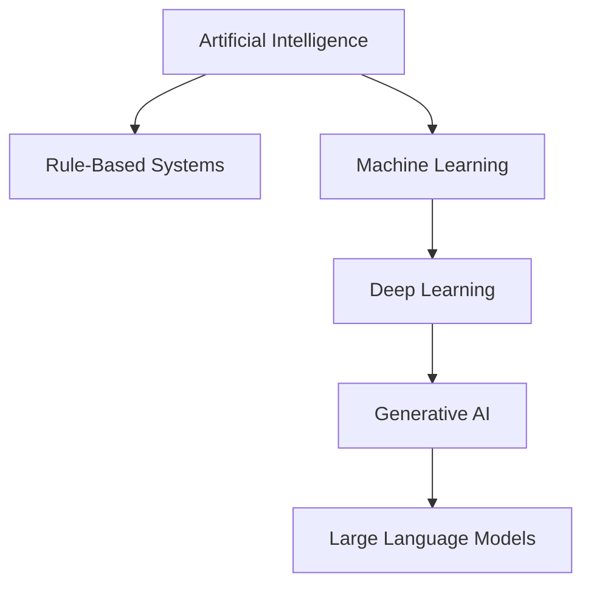
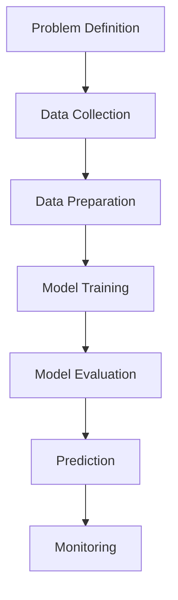

# VLSIGuru AI Literacy Layer – Week 02

**Name:** Bandi Ravali  
**Track:** AI Literacy Layer  
**Program:** VLSIGuru AI Literacy Layer – 16-Week Program  
**Week:** 02

## Machine Learning Foundations

### Purpose

The purpose of this assessment is to understand the basics of Machine Learning, how models learn from data, how their performance is evaluated, and how ML can be applied to real-world engineering problems.

### Weekly Missions

| Mission | Topic |
|---|---|
| Mission 1 | AI and ML Landscape |
| Mission 2 | Understanding Data |
| Mission 3 | Learning Approaches |
| Mission 4 | ML Task Types |
| Mission 5 | Model Anatomy |
| Mission 6 | Model Evaluation |
| Mission 7 | ML Failure Modes |
| Mission 8 | When to Use ML |
| Mission 9 | Semiconductor Case Study |

### Learning Objectives

- Understand AI, ML, Deep Learning and Generative AI.
- Learn about datasets, features, labels and targets.
- Understand supervised, unsupervised, reinforcement and self-supervised learning.
- Identify classification, regression, clustering and anomaly detection.
- Understand model training, inference, loss and optimisation.
- Learn about training, validation and test datasets.
- Understand overfitting, underfitting and generalisation.
- Identify common Machine Learning failure modes.
- Compare rule-based programming and Machine Learning.
- Explore ML applications in semiconductor Physical Design.

### Concept Map

### Machine Learning Lifecycle

### Key Learnings

1. Machine Learning learns patterns from data.
2. Data quality is important for reliable predictions.
3. Different ML approaches are suitable for different problems.
4. Model evaluation helps measure performance on unseen data.
5. Overfitting and data leakage can affect model reliability.
6. Rule-based programming can be more suitable for simple, fixed conditions.
7. ML can potentially help identify routing congestion in semiconductor Physical Design.

### Semiconductor Application

This assessment explores a proposed use of Machine Learning for early routing congestion prediction in Physical Design.

Historical design data could be used to train a model to estimate possible congestion hotspots. The predictions would need to be evaluated against actual EDA results and reviewed by engineers.

This is a proposed case study, not an implemented or experimentally validated project.

### Skills I Expect to Build

- AI and ML fundamentals
- Data understanding and preparation
- Model evaluation
- Critical thinking and problem-solving
- Technical documentation
- GitHub and Markdown
- Understanding AI applications in semiconductor engineering

### References

1. Google Machine Learning Crash Course: https://developers.google.com/machine-learning/crash-course
2. Google Introduction to Machine Learning: https://developers.google.com/machine-learning/intro-to-ml
3. scikit-learn Documentation: https://scikit-learn.org/stable/
4. NIST AI Risk Management Framework: https://www.nist.gov/itl/ai-risk-management-framework
5. Semiconductor congestion prediction research: https://www.mdpi.com/2079-9292/10/16/1995

### Conclusion

This week's assessment helped me organise my understanding of Machine Learning fundamentals, data, model evaluation and common failure modes. It also introduced me to a possible application of AI in semiconductor Physical Design.

I aim to continue building my AI knowledge and applying these concepts to engineering problems.
