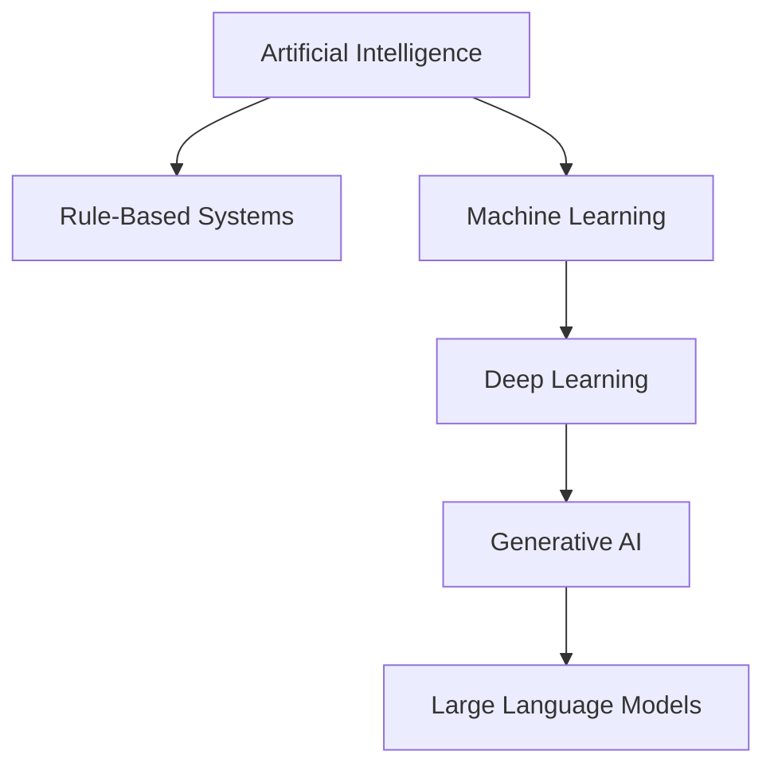

# Mission 1: Build the AI and ML Landscape

## 1. Introduction

Artificial Intelligence (AI) is a field of computer science that develops systems capable of tasks such as reasoning, recognising patterns, understanding language and making decisions.

Machine Learning (ML) is a branch of AI that enables systems to learn patterns from data and use them to make predictions or decisions.

## 2. AI, Rule-Based Programming and ML

| Feature | Rule-Based Programming | Machine Learning |
|---|---|---|
| Working method | Follows explicit rules written by a programmer | Learns patterns from examples |
| Data requirement | Depends on the task and rules | Requires suitable data for learning |
| Adaptation | Rules must be changed explicitly | May require retraining with new data |
| Best suited for | Clear, fixed conditions | Patterns that are difficult to express as fixed rules |
| Example | Checking whether a number is positive | Predicting whether a chip design will pass timing |

AI is the broad field. Rule-based systems and ML are different approaches that can be used to develop AI applications.

## 3. Relationship Between AI and Related Concepts

| Concept | Meaning | Example |
|---|---|---|
| Artificial Intelligence | Broad field of intelligent computer systems | An AI assistant |
| Machine Learning | Learning patterns from data | Predicting timing failures |
| Deep Learning | ML using neural networks with multiple layers | Image recognition |
| Generative AI | AI that generates new content | Generating a written explanation |
| Large Language Model (LLM) | Model designed to process and generate language | Answering questions in natural language |

These concepts are related but are not interchangeable. Generative AI can use different model architectures, and not every AI application uses ML.

## 4. Concept Map

This is a simplified conceptual map. The branches are not exhaustive, and generative AI is not limited to one architecture.

## 5. Five Important Distinctions

1. AI is the broad field, while ML is one approach within AI.
2. Rule-based programming follows explicitly written rules, while ML learns patterns from data.
3. Deep learning is a type of ML based on multilayer neural networks.
4. Generative AI creates content, while many other AI systems classify or predict.
5. LLMs focus on language tasks, whereas generative AI also includes image, audio and other content-generation systems.

## 6. Three Examples and Their Classification

| Example | Classification | Reason |
|---|---|---|
| A program that checks whether a number is positive | Rule-based program | It follows an explicit condition |
| A model that predicts whether a design will pass timing | Machine Learning | It learns from historical design examples |
| An assistant that generates a new paragraph | Generative AI | It generates new text |

## 7. Why Automation Is Not Always AI

Automation means performing tasks with reduced manual effort. A fixed timer that switches off a light is automation, but it does not necessarily use AI.

AI is not always ML either. An expert system can use manually defined rules to make decisions without learning from data.

## 8. Conclusion

Understanding the AI landscape helps engineers select suitable techniques. The choice should depend on the problem, available data, required output and limitations of the proposed system.

## 9. Sources

1. Google for Developers — Introduction to Machine Learning:
   https://developers.google.com/machine-learning/intro-to-ml
2. IBM — What Is Artificial Intelligence?:
   https://www.ibm.com/think/topics/artificial-intelligence
3. IBM — What Is Machine Learning?:
   https://www.ibm.com/think/topics/machine-learning
