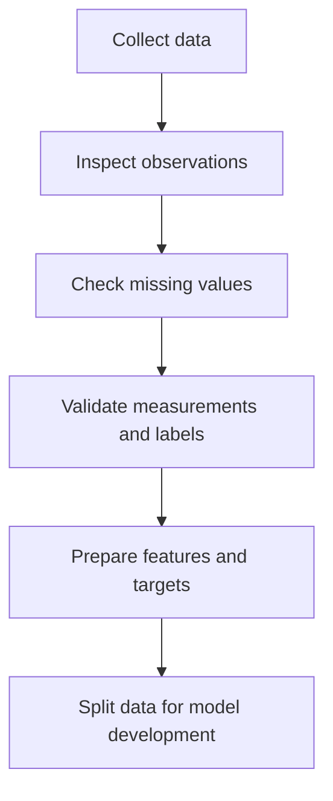

# Mission 2: Understand Data

## 1. Introduction

Machine Learning systems learn patterns from examples. A dataset contains observations that can be used to train, evaluate or investigate a model.

Data quality is important because missing values, incorrect labels and unrepresentative examples can lead to unreliable predictions.

## 2. Important Data Terms

| Term | Meaning | Example |
|---|---|---|
| Dataset | Collection of observations | Historical Physical Design runs |
| Sample | One observation | One design run |
| Feature | Input variable | Cell count |
| Label | Known answer for an example | Timing Pass or Fail |
| Target | Outcome to predict | Timing result |
| Structured data | Organised into rows and columns | A CSV file |
| Unstructured data | Data without a fixed tabular structure | Images or free-form text |
| Numerical feature | A measured or counted value | Delay in nanoseconds |
| Categorical feature | A category or group | Design type |

## 3. Illustrative Dataset

The following dataset contains synthetic example values. They are not real chip measurements.

| Run | Cell Count | Utilization (%) | Delay (ns) | Timing Result |
|---|---:|---:|---:|---|
| 1 | 1000 | 55 | 0.80 | Pass |
| 2 | 1200 | 60 | 0.95 | Pass |
| 3 | 1500 | 70 | 1.20 | Fail |
| 4 | 900 | 50 | 0.75 | Pass |
| 5 | 1800 | 75 | 1.35 | Fail |
| 6 | 1300 | 65 | 1.05 | Pass |

### Identifying the Features and Target

- Features: Cell count, utilization and delay.
- Target: Timing result.
- Labels: Pass and Fail.
- Dataset type: Structured tabular data.
- Possible ML task: Classification.

For this example, the timing results are assumed to come from a valid timing-analysis process.

## 4. Labelled Versus Unlabelled Data

Labelled data contains examples with known answers. It is useful for supervised learning.

Unlabelled data contains examples without supplied target labels. It can be used to discover patterns through approaches such as clustering.

## 5. How Data Quality Affects a Model

### Issue 1: Missing Measurements

If some delay values are missing, the model may not have enough information to learn a reliable relationship.

Possible solution: Investigate the missing values and choose an appropriate handling method.

### Issue 2: Incorrect Labels

If a timing-failing design is incorrectly labelled Pass, the model receives misleading training information.

Possible solution: Compare labels with trusted timing reports and correct verified errors.

Other issues include noisy measurements, duplicate records, inconsistent units and unrepresentative data.

## 6. Why More Data Does Not Always Mean Better Data

A large dataset may still be unreliable if it contains incorrect measurements, poor labels or examples that do not represent the intended application.

A smaller, relevant and carefully checked dataset can be more useful than a larger dataset with serious quality problems.

## 7. Data Preparation Flow

## 8. Conclusion

Data is the foundation of Machine Learning. Before training a model, engineers should understand the source, quality, features and labels of the dataset.

## 9. Sources

1. Google ML Crash Course — Datasets:
   https://developers.google.com/machine-learning/crash-course/overfitting
2. Kaggle Learn — Intro to Machine Learning:
   https://www.kaggle.com/learn/intro-to-machine-learning
3. Google ML Crash Course — Working with Numerical Data:
   https://developers.google.com/machine-learning/crash-course/numerical-data
