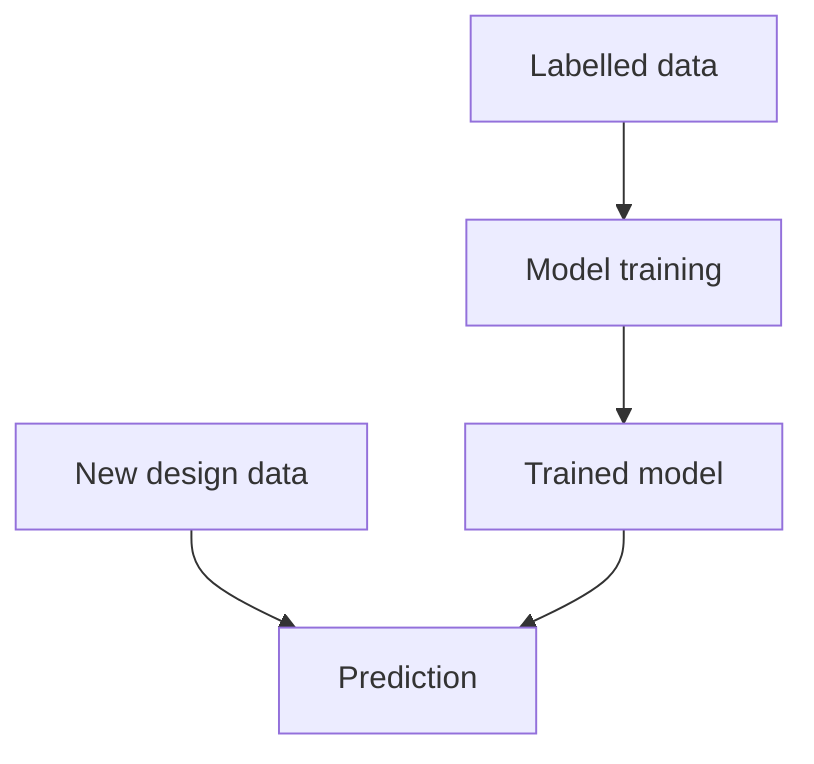
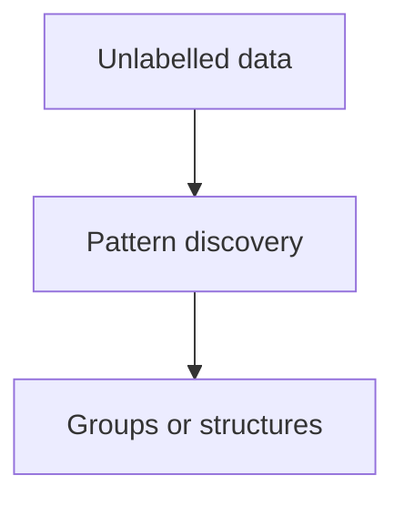
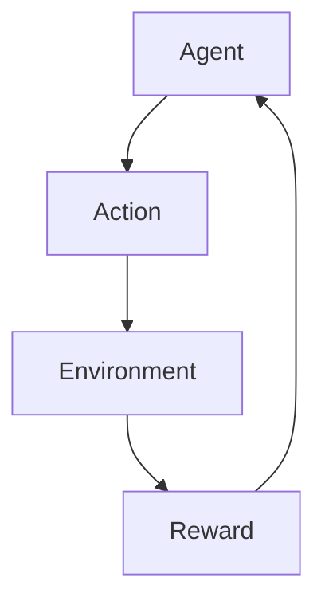
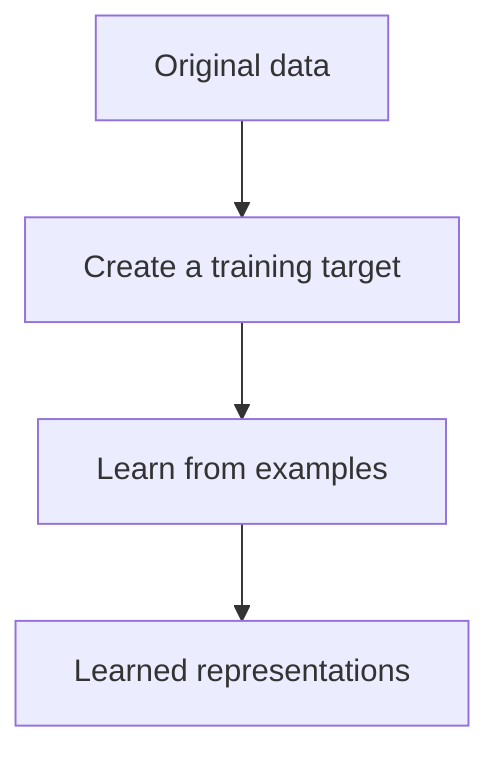

# Mission 3: Understand the Main ML Approaches

## 1. Introduction

Machine Learning approaches differ according to the type of information or feedback available during learning.

The main approaches are supervised learning, unsupervised learning, reinforcement learning and self-supervised learning.

## 2. Comparison Table

| Approach | Learning Signal | Example | Limitation |
|---|---|---|---|
| Supervised learning | Labelled examples | Predict timing Pass/Fail | Requires reliable labels |
| Unsupervised learning | Unlabelled examples | Group similar design runs | Discovered groups may be difficult to interpret |
| Reinforcement learning | Rewards or penalties | Explore design parameter settings | Reward design can be difficult |
| Self-supervised learning | Targets created from the data itself | Predict a hidden part of an input | The learned patterns may not suit the final task |

## 3. Supervised Learning

Supervised learning uses examples with known target answers. The model learns relationships between inputs and outputs.

Example: Training a model using historical Physical Design data to predict whether a new design run will pass timing.

Suitable when trustworthy labels or numerical targets are available.

## 4. Unsupervised Learning

Unsupervised learning explores data without supplied target labels to discover patterns or structures.

Example: Grouping design runs with similar utilization, delay and congestion characteristics.

Limitation: The discovered groups may not have an obvious engineering meaning.

## 5. Reinforcement Learning

Reinforcement learning involves an agent taking actions and receiving rewards or penalties from an environment. It learns a strategy intended to improve its cumulative reward.

Example: An experimental agent explores Physical Design parameter settings and receives rewards based on defined timing, power and area objectives.

Limitation: Poorly designed rewards can encourage undesirable behaviour, and exploration may be computationally expensive.

## 6. Self-Supervised Learning

Self-supervised learning creates training targets from the data itself.

Example: A model receives an input with a hidden portion and learns to predict the missing content.

Self-supervised learning can use unlabelled data, but it creates a specific learning signal from that data. It is related to unsupervised learning, but the terms are not interchangeable in every context.

## 7. When Is Each Approach Suitable?

| Approach | Suitable Situation |
|---|---|
| Supervised | Known answers are available |
| Unsupervised | The goal is to explore unknown patterns |
| Reinforcement | Actions affect later outcomes and feedback is available |
| Self-supervised | Training targets can be derived from the data itself |

## 8. Conclusion

The choice of learning approach depends on the problem, data and feedback available. No single approach is best for every application.

## 9. Sources

1. Google — Introduction to Machine Learning:
   https://developers.google.com/machine-learning/intro-to-ml
2. IBM — What Is Machine Learning?:
   https://www.ibm.com/think/topics/machine-learning
3. OpenAI — Spinning Up in Deep RL:
   https://spinningup.openai.com/en/latest/
