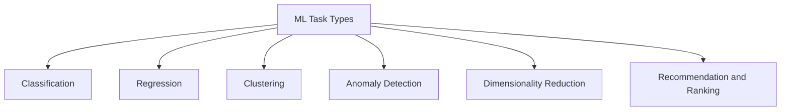

# Mission 4: Understand ML Task Types

## 1. Introduction

An ML task describes the type of problem a model is expected to solve. Different tasks produce different outputs, including categories, numerical values, groups or warnings.

A task type is different from a learning approach. For example, classification is a task, while supervised learning is an approach that can be used to train a classifier.

## 2. Comparison of ML Tasks

| Task Type | Purpose | Example Input | Expected Output |
|---|---|---|---|
| Classification | Predict a category | Design measurements | Pass or Fail |
| Regression | Predict a numerical value | Cell and timing features | Estimated delay |
| Clustering | Group similar observations | Measurements from design runs | Groups of similar runs |
| Anomaly detection | Identify unusual observations | Sensor measurements | Anomaly flag |
| Dimensionality reduction | Represent data using fewer dimensions | Many measured features | Lower-dimensional representation |
| Recommendation/ranking | Order possible choices | Candidate design configurations | Ranked configurations |

## 3. Six Real-World Examples

| Example | Input | Output | Task |
|---|---|---|---|
| 1. Email filtering | Email features | Spam or not spam | Classification |
| 2. House-price prediction | Property characteristics | Estimated price | Regression |
| 3. Customer grouping | Customer activity data | Customer groups | Clustering |
| 4. Equipment monitoring | Sensor readings | Unusual-pattern warning | Anomaly detection |
| 5. Data visualisation | Many correlated variables | Reduced feature representation | Dimensionality reduction |
| 6. Physical Design exploration | Candidate configurations | Ranked configurations | Recommendation/ranking |

## 4. Semiconductor Applications

### Application A: Timing Prediction

- Input: Relevant design characteristics and timing-related features.
- Output: Predicted Pass or Fail result.
- Task type: Classification.

### Application B: Delay Estimation

- Input: Historical design measurements and implementation features.
- Output: Estimated delay in nanoseconds.
- Task type: Regression.

These are possible applications. Their practical performance depends on suitable data and validation.

## 5. Concept Map

## 6. Task Type Versus Learning Approach

| Learning Approach | Possible Task |
|---|---|
| Supervised learning | Classification or regression |
| Unsupervised learning | Clustering or dimensionality reduction |
| Reinforcement learning | Learning a strategy for sequential decisions |
| Self-supervised learning | Learning from targets derived from data |

These are common relationships, not strict one-to-one mappings. The suitable approach depends on the formulation of the problem.

## 7. Conclusion

Understanding the required output helps engineers select a suitable ML task and evaluation metric. A clear task definition should come before choosing an algorithm.

## 8. Sources

1. Google ML Crash Course — Classification:
   https://developers.google.com/machine-learning/crash-course/classification
2. Google ML Crash Course — Linear Regression:
   https://developers.google.com/machine-learning/crash-course/linear-regression
3. scikit-learn — Clustering:
   https://scikit-learn.org/stable/modules/clustering.html
4. scikit-learn — Dimensionality Reduction:
   https://scikit-learn.org/stable/modules/unsupervised_reduction.html
