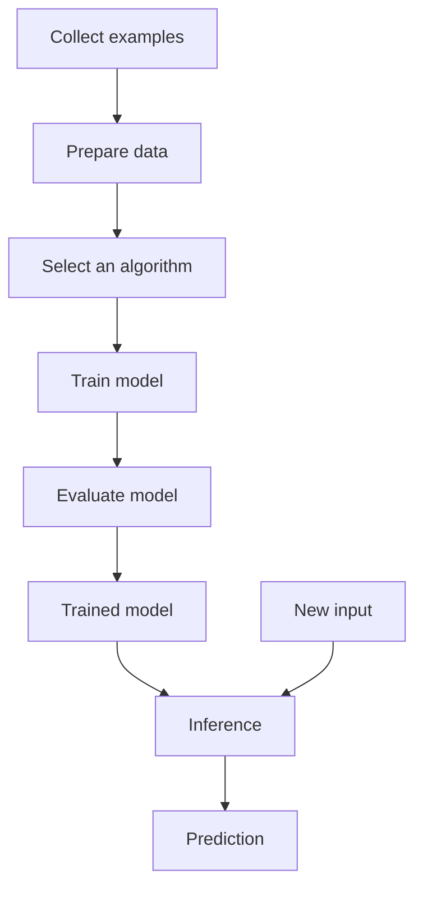

# Mission 5: Understand the Anatomy of an ML Model

## 1. Introduction

An ML model learns patterns from training data and uses them to produce predictions for new inputs.

The model development process includes data preparation, training, evaluation and inference.

## 2. Important Terms

| Term | Meaning |
|---|---|
| Algorithm | A procedure used to learn from data |
| Model | A learned system that produces outputs from inputs |
| Parameters | Values learned during training |
| Training | Learning patterns from examples |
| Inference | Using a trained model to produce an output |
| Loss | A numerical measure of prediction error under a chosen loss function |
| Optimisation | Adjusting parameters to improve the objective being optimised |

## 3. ML Model Lifecycle

If evaluation reveals problems, the developer may need to revisit the data, features or model.

## 4. Training Versus Inference

| Training | Inference |
|---|---|
| Learns patterns from examples | Uses the trained model |
| Adjusts model parameters | Usually keeps learned parameters fixed |
| Uses training data | Uses new input data |
| Produces a fitted model | Produces a prediction or output |

Example: A model learns from historical design runs during training. During inference, it estimates the delay of a new design configuration.

## 5. Understanding Loss and Optimisation

A model's prediction can be compared with the known target during training. A loss function measures the error according to a chosen mathematical rule.

An optimisation method attempts to improve the training objective by adjusting model parameters.

A lower training loss does not guarantee good predictions on unseen data. Independent evaluation is needed.

## 6. Linear Regression

Linear regression is a supervised learning method used to predict numerical values.

A simple model can be written as:

`Predicted delay = w × utilization + b`

Where:

- `utilization` is an input feature.
- `w` is a learned weight.
- `b` is a learned bias or intercept.
- `predicted delay` is the output.

During training, the model learns the weight and bias from examples. Real Physical Design delay depends on many factors, so a practical model may need additional features.

## 7. Example

Suppose a model uses historical design data to estimate delay. During training, it learns a relationship between utilization and observed delay. When a new utilization value is supplied, it calculates an estimated delay.

This is an illustration of the process, not a claim that a trained model has been built.

## 8. Conclusion

An ML model is created by learning from data and is used through inference. Understanding parameters, loss, optimisation and evaluation helps engineers judge whether a prediction is useful.

## 9. Sources

1. Google ML Crash Course — Linear Regression:
   https://developers.google.com/machine-learning/crash-course/linear-regression
2. Google ML Crash Course — Gradient Descent:
   https://developers.google.com/machine-learning/crash-course/gradient-descent
3. scikit-learn — Linear Models:
   https://scikit-learn.org/stable/modules/linear_model.html
