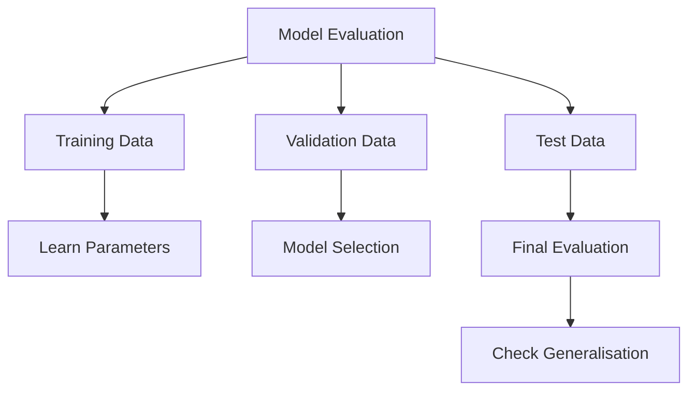

# Mission 6: Understand Evaluation and Generalisation

## 1. Introduction

Model evaluation determines whether an ML model produces useful predictions. A model should perform well on new, unseen examples, not only on data used during training.

## 2. Training, Validation and Test Sets

| Dataset | Purpose |
|---|---|
| Training set | Used to learn model parameters |
| Validation set | Used to compare models and tune settings |
| Test set | Used for final evaluation on held-out examples |

The test set should remain separate from training and model selection to provide a more independent estimate of performance.

## 3. Generalisation, Overfitting and Underfitting

| Concept | Meaning | Example |
|---|---|---|
| Generalisation | Performing usefully on unseen data | Predicting outcomes for new design runs |
| Overfitting | Learning patterns that do not generalise well | Excellent training performance but poor test performance |
| Underfitting | Failing to learn important patterns | Poor performance on both training and test data |

## 4. Evaluation Metrics

| Metric | What It Measures |
|---|---|
| Accuracy | Proportion of all predictions that are correct |
| Precision | Proportion of predicted positives that are actually positive |
| Recall | Proportion of actual positives that are identified |
| False positive | A negative example incorrectly predicted as positive |
| False negative | A positive example incorrectly predicted as negative |
| Mean Absolute Error (MAE) | Average absolute difference between numerical predictions and actual values |

The positive class should be defined clearly. In a timing-failure detector, for example, Fail could be treated as the positive class.

## 5. Worked Example: Why Accuracy Can Mislead

Suppose a test dataset contains 100 design runs:

- 95 runs pass timing.
- 5 runs fail timing.

Consider a model that predicts Pass for every run.

| Evaluation Result | Number |
|---|---:|
| Correct Pass predictions | 95 |
| Correct Fail predictions | 0 |
| Total examples | 100 |
| Accuracy | 95% |
| Recall for Fail cases | 0% |

The model achieves 95% accuracy but misses every timing failure.

### Calculation

Accuracy = Correct predictions / Total predictions

Accuracy = 95 / 100 = 95%

Recall for Fail cases = Correctly identified failures / Actual failures

Recall = 0 / 5 = 0%

This example demonstrates why accuracy alone can be misleading when the classes are imbalanced.

Precision for the Fail class is also useful when the model identifies some failures. It measures how many predicted failures are actual failures.

## 6. Concept Map

## 7. How to Improve Evaluation

1. Keep training, validation and test data separate.
2. Use representative data.
3. Compare performance against a simple baseline.
4. Select metrics that match the consequences of errors.
5. Investigate performance across different subsets.
6. Avoid data leakage.

## 8. Conclusion

Evaluation helps determine whether an ML model is useful beyond its training data. Engineers should consider multiple suitable metrics and test on independent examples rather than relying only on accuracy.

## 9. Sources

1. Google ML Crash Course — Classification:
   https://developers.google.com/machine-learning/crash-course/classification
2. Google ML Crash Course — Overfitting and Generalisation:
   https://developers.google.com/machine-learning/crash-course/overfitting
3. scikit-learn — Model Evaluation:
   https://scikit-learn.org/stable/modules/model_evaluation.html
