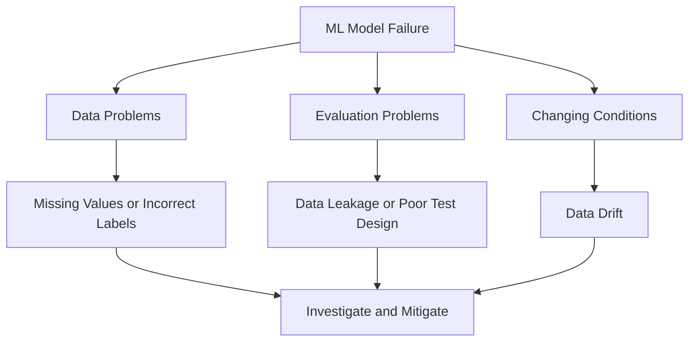

# Mission 7: Understand Why ML Systems Fail

## 1. Introduction

An ML model can produce incorrect predictions even when it performed well during testing. Common reasons include poor-quality data, bias, data leakage, changing input conditions and model limitations.

## 2. Common Failure Causes

| Failure Cause | Meaning | Possible Effect |
|---|---|---|
| Poor-quality data | Missing, inaccurate or noisy measurements | Unreliable predictions |
| Data bias | Data does not adequately represent relevant cases | Uneven performance |
| Incorrect labels | Training targets contain errors | The model learns misleading relationships |
| Data leakage | Unavailable or inappropriate information enters training or evaluation | Performance appears better than it really is |
| Data drift | Input data changes over time | Model performance may deteriorate |
| Overfitting | Model learns patterns that do not generalise | Poor performance on unseen data |

## 3. Failure Analysis 1: Incorrect Timing Predictions

### Situation

An ML model predicts that a Physical Design run will pass timing, but the actual timing report shows a failure.

**Possible cause:** Incorrect timing labels or inaccurate delay measurements in the training dataset.

**Evidence to investigate:**
- Compare labels with trusted timing reports.
- Check measurement units and missing values.
- Compare predictions with independent design runs.

**Possible mitigation:**
- Correct verified data errors.
- Improve data validation.
- Retrain and evaluate on representative examples.

## 4. Failure Analysis 2: Poor Performance on New Designs

### Situation

A model performs well on familiar design blocks but poorly on a new design.

**Possible cause:** The training data does not adequately represent the new design characteristics.

**Evidence to investigate:**
- Compare training and new-design feature distributions.
- Evaluate results separately for different design types.
- Check whether the test dataset represents the intended application.

**Possible mitigation:**
- Collect suitable representative examples.
- Test on previously unseen designs.
- Retrain or adapt the model when supported by evidence.

## 5. Failure Analysis 3: Misleading Evaluation Results

### Situation

A model appears highly accurate during evaluation but performs poorly in practical use.

**Possible cause:** Data leakage has allowed information related to the target to enter the model inappropriately.

**Evidence to investigate:**
- Review how each feature was collected.
- Check whether a feature would be available at prediction time.
- Audit the training and test-data preparation process.

**Possible mitigation:**
- Remove invalid features.
- Correct the data pipeline.
- Repeat evaluation using an independent test set.

## 6. Importance of Human Oversight

Predictions should be checked before they are used for important engineering decisions. Engineers must investigate unexpected results and understand model limitations.

In Physical Design, an ML prediction must not replace required EDA analysis or engineering sign-off checks.

## 7. Concept Map

## 8. Conclusion

Reliable ML systems require high-quality data, independent evaluation, monitoring and human oversight. When a model fails, engineers should investigate evidence rather than assume that retraining alone will solve the problem.

## 9. Sources

1. Google ML Crash Course — Production ML Systems:
   https://developers.google.com/machine-learning/crash-course/production-ml-systems
2. Google ML Crash Course — Overfitting:
   https://developers.google.com/machine-learning/crash-course/overfitting
3. NIST — AI Risk Management Framework:
   https://www.nist.gov/itl/ai-risk-management-framework
