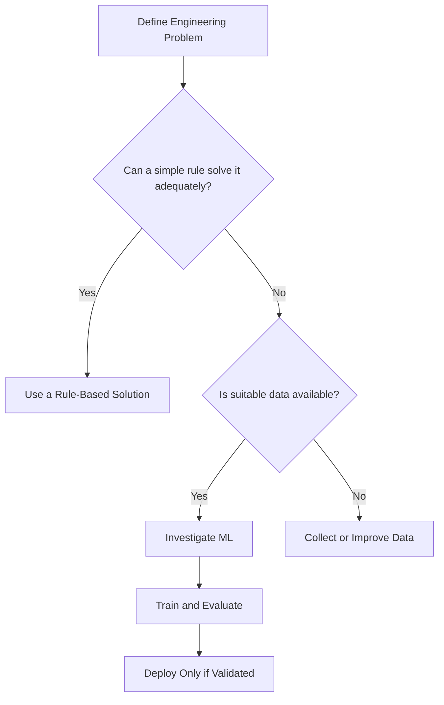

# Mission 8: Does This Problem Actually Need ML?

## 1. Introduction

Machine Learning is not automatically the best solution for every engineering problem. An engineer should first understand the problem, define the required output and determine whether a fixed rule or conventional program is sufficient.

## 2. Example Problem: Identifying High Utilization

Suppose an engineering team wants to flag a Physical Design run whenever utilization exceeds a predefined threshold.

### Rule-Based Solution

A program can compare utilization with a fixed threshold.

```python
utilization = 78
threshold = 70

if utilization > threshold:
    print("High utilization")
else:
    print("Utilization within threshold")
```

This is an illustrative example. The appropriate threshold depends on the engineering requirements.

### Advantages

- Simple to understand.
- Does not require an ML training dataset.
- Easy to test and maintain.
- Produces predictable results for the defined rule.

### Limitations

- The rule must be updated explicitly.
- A single threshold may not represent every design condition.
- It does not learn complex relationships from historical examples.

## 3. Possible ML Solution

An ML model could use multiple features, such as utilization, placement characteristics and historical congestion measurements, to predict the likelihood of routing congestion.

### Advantages

- Can learn relationships from historical examples.
- May identify patterns that are difficult to express with simple rules.
- Can combine multiple input features.

### Limitations

- Requires suitable training data.
- Can perform poorly on unfamiliar designs.
- Needs evaluation and maintenance.
- Predictions may be difficult to interpret.

## 4. Comparison Table

| Factor | Rule-Based Solution | ML Solution |
|---|---|---|
| Method | Explicit conditions | Patterns learned from data |
| Training data | Not required for the fixed rule | Required for data-driven training |
| Interpretability | Usually straightforward | Depends on the model |
| Adaptation | Explicit rule changes | May require retraining |
| Best suited for | Clear, stable conditions | Problems with useful learnable patterns |
| Main risk | Rules may be incomplete | Predictions may not generalise |

## 5. Decision Checklist

Before choosing ML, an engineer should ask:

1. Is the problem clearly defined?
2. Can a simple rule solve it adequately?
3. Is reliable, representative data available?
4. What output should the model produce?
5. How will success be measured?
6. What happens if a prediction is incorrect?
7. Can the prediction be independently verified?

## 6. Concept Map



This is a simplified decision guide. Even when data is available, ML should be selected only if it provides sufficient value and can be evaluated appropriately.

## 7. Conclusion

Engineers should start with the problem rather than the technology. Rule-based programs are often effective for clear conditions, while ML may help when useful patterns are difficult to express with fixed rules.

## 8. Sources

1. Google — Problem Framing:
   https://developers.google.com/machine-learning/problem-framing
2. Google ML Crash Course — Introduction:
   https://developers.google.com/machine-learning/intro-to-ml
3. NIST — AI Risk Management Framework:
   https://www.nist.gov/itl/ai-risk-management-framework
