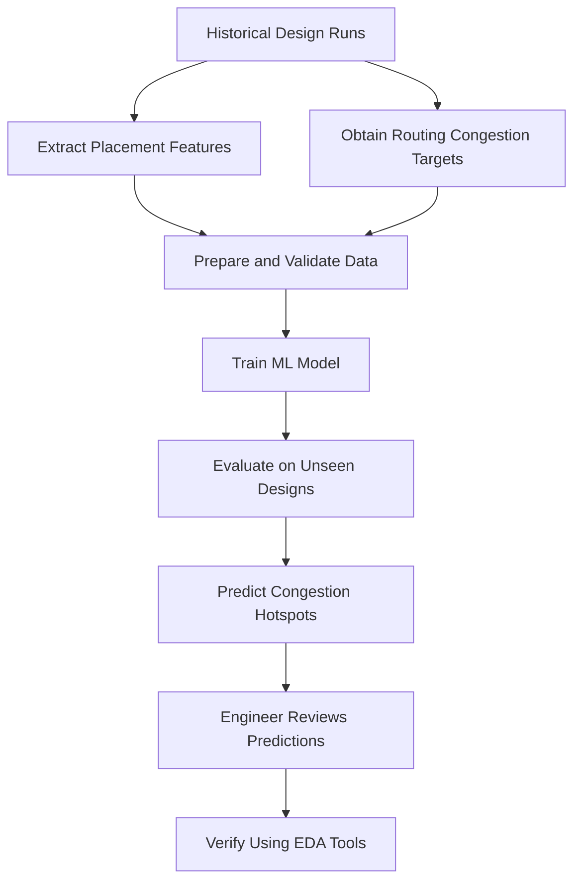

# Mission 9: ML in Semiconductor Engineering

## Case Study: Early Routing Congestion Prediction in Physical Design

## 1. Introduction

Physical Design is a stage of semiconductor development that includes floorplanning, placement, clock tree synthesis and routing.

Routing congestion occurs when the demand for routing resources becomes too high in certain regions of a design. It can make routing more difficult and affect design closure.

Machine Learning can be investigated as a way to estimate congestion before the final routing stage.

## 2. Engineering Problem

In a conventional implementation flow, engineers use EDA tools to analyse a design as it progresses through Physical Design.

Some congestion issues may become clearer only after additional implementation steps. An early prediction model could help identify regions that require further investigation.

The aim is to support engineering decisions, not to replace EDA tools or final verification.

## 3. Data Required

A possible dataset could contain:

- Placement and cell-location information.
- Cell density and utilization measurements.
- Netlist connectivity features.
- Routing-resource information.
- Placement-stage congestion indicators.
- Congestion measurements from a later routing stage.

The exact features depend on the model and available design flow. Only authorised design data should be used.

## 4. Proposed ML Approach

A possible approach is supervised learning using historical design runs.

The input features would come from an earlier design stage, and the target values would represent congestion observed at a later stage.

The model would learn relationships between early design characteristics and later congestion.

## 5. Concept Map

This represents a proposed workflow, not an implementation completed as part of this assignment.

## 6. ML Task Type

| Approach | Target | Output |
|---|---|---|
| Regression | Numerical congestion measurement | Estimated congestion value |
| Classification | Congestion threshold | Likely hotspot or no hotspot |
| Spatial prediction | Congestion across design regions | Estimated congestion map |

The task type depends on the output selected for the problem.

## 7. Evaluation Plan

1. Prepare separate training, validation and test datasets.
2. Evaluate on designs not used for training.
3. Use Mean Absolute Error (MAE) for numerical predictions.
4. Use precision and recall for hotspot classification.
5. Compare predictions with actual routing results.
6. Compare performance with a simple baseline.
7. Investigate performance across different design types.

Test data should represent the intended application. Good performance on familiar designs does not guarantee good performance on new designs.

## 8. Potential Benefits

If sufficiently accurate, an ML model may help engineers:

- Identify possible congestion hotspots earlier.
- Prioritise regions for further investigation.
- Compare candidate placement configurations.
- Reduce some unnecessary implementation experiments.
- Make better-informed decisions during design iterations.

These are potential benefits that require experimental validation.

## 9. Limitations and Risks

- Poor-quality training data may produce unreliable predictions.
- New designs may differ from the training examples.
- Predictions may not capture every physical effect.
- False predictions may create unnecessary engineering work.
- Model performance may change as design conditions change.
- Final EDA analysis and engineering verification remain necessary.

## 10. Research Sources

### Source 1: Congestion Prediction in FPGA Using Regression Based Learning Methods

This research paper investigates ML-based prediction of FPGA routing congestion.

Link:
https://www.mdpi.com/2079-9292/10/16/1995

Use this source to investigate the research problem, learning approach and evaluation described in the paper.

### Source 2: Routing Congestion Prediction in VLSI Design Using Graph Neural Networks

This research paper investigates the use of graph neural networks for congestion prediction in VLSI layout design.

Link:
https://doi.org/10.1109/dspa60853.2024.10510092

Review the original paper to verify its methodology, results and limitations before citing specific numerical findings.

## 11. Conclusion

Early routing congestion prediction is an example of how Machine Learning may support semiconductor Physical Design. A model can learn from historical design data and provide estimates that help engineers identify areas for further investigation.

However, the predictions must be evaluated on unseen designs and checked against actual EDA results. ML should support sound engineering decisions rather than replace required verification.
